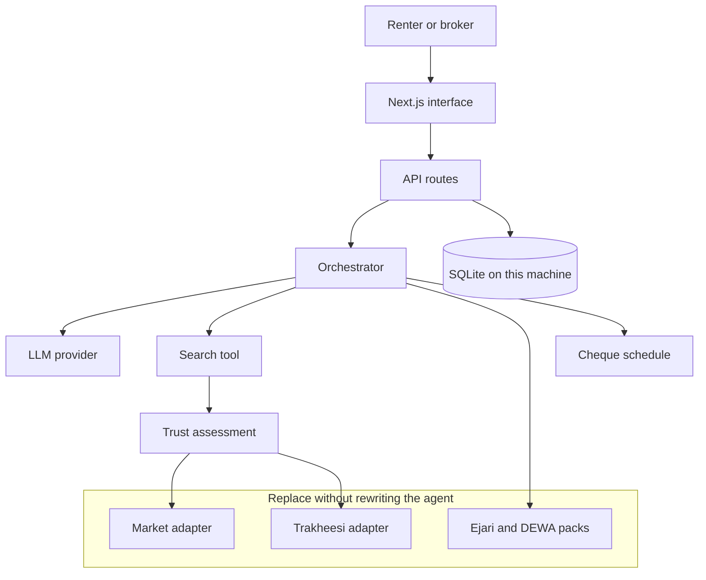

# Dubai Safe Rent Agent

A pilot agent for a safer Dubai rental. Someone types a brief in plain English. The agent reads it, lines up candidate homes, and scores each one for trust: listing permit, broker licence, price against a sample market band, and the fraud patterns Dubai Police warn about. It then walks the deal from viewing to cheques.

This is the working prototype for the Create AI Agents Championship, Best Business AI Agent. The pilot user is Kerem, a developer who starts as a Dubai real estate broker on 6 November 2026. The January 2027 submission needs this prototype, a pitch deck, and a demo video, in English.

Rentals only. Sales paperwork is named so it is not confused with a tenancy, and then left unused.

## Run it

Node.js 22 or newer. One command from a fresh clone:

```bash
npm install && npm run dev
```

Open [http://localhost:3000](http://localhost:3000). Choose **Try the JVC brief**, then run:

> furnished 1BR in JVC around 7,000 AED/month, newer building with gym

No API key is required. With `LLM_PROVIDER=mock` (the default, and the result when no key is set) the shortlist, the scores, and the written summary are deterministic. The demo does not call a model.

```bash
npm test
npm run build
```

Deals are stored in `data/safe-rent.db`. That file is created on first use and is gitignored.

## What the JVC brief does

1. The brief is read as a furnished one-bedroom in Jumeirah Village Circle, near AED 7,000 a month, in a building completed in 2019 or later, with a gym.
2. The sample registry is filtered and ranked on area, size, furnishing, budget, age, and amenities.
3. Each kept listing is checked for a Trakheesi-style permit and for RERA office (ORN) and broker (BRN) fields.
4. Annual rent is compared with a sample median shaped like a Dubai Pulse / DLD open Ejari aggregate.
5. Dubai Police patterns are applied: price far under the market, money before a viewing, no permit, refusal to register Ejari, a personal account, social-media-only contact, pressure to pay today.
6. A trust score from 0 to 100 is shown with the reasons. A matching listing that fails those checks is kept on screen under **Do not pay**, not dropped.
7. **Open guided deal** writes a local file: viewing, offer, contract, Ejari pack, DEWA move-in, and a cheque picture. The broker desk lists active files and the document statuses.

Court Eight in the sample set is a clean match. The social-only listing is priced far under the band, has no permit, and asks for money before a viewing. It scores 0.

## Trust model

A clean listing starts at 100. Deductions stack and the score is clamped at 0.

| Check | Deduction | Severity |
| --- | --- | --- |
| No permit number | 40 | Critical |
| Permit fails the 10–12 digit sample shape | 28 | Warning |
| Permit well formed, absent from the sample registry | 12 | Warning |
| No office licence (ORN) | 22 | Warning |
| ORN fails the 4–6 digit sample shape | 14 | Warning |
| No broker number (BRN) | 8 | Warning |
| BRN fails the sample shape | 6 | Warning |
| Under 70% of the sample median | 30 | Critical |
| 70% to 85% of the sample median | 12 | Warning |
| Over 135% of the sample median | 6 | Note |
| Payment before a viewing | 25 | Critical |
| Refuses Ejari | 18 | Critical |
| Personal account only | 15 | Warning |
| Social-media only | 10 | Warning |
| Pressure to decide immediately | 8 | Warning |

Bands: **Trusted** at 85 or above with no warning or critical flag. **Review** at 70 or above without a critical flag. **Caution** when a critical flag remains but the score is still at least 70, or when the score is 45–69 with no critical flag. **Avoid** otherwise. A critical flag can never read as trusted.

The permit and licence shapes are sample-mode checks. They are not an official DLD validation rule. A number that is only “well formed” is not treated as verified.

## Sample data, on purpose

Ejari and DEWA do not offer a public API. The DLD Trakheesi API is available to licensed entities, which this pilot is not, until Kerem is licensed. Until then:

- Listings, permit numbers, office names, ORN, and BRN values are fictional.
- Market bands are labelled in the interface as a sample shaped like open Ejari aggregates for 2025-H2. They are not a live Dubai Pulse extract.
- Registration steps produce a checklist and a cheque picture. A person submits them on Dubai REST, at a trustee centre, or in the DEWA app.

The adapter boundary is `src/lib/adapters/index.ts`.

- `getTrakheesiAdapter()` returns the sample registry unless `TRAKHEESI_ADAPTER=live`, in which case the live adapter throws a clear “not wired” error rather than inventing a response.
- `getMarketAdapter()` does the same for `MARKET_ADAPTER=live`.
- Ejari and DEWA adapters only return a prepared pack. There is no `submit()`.

If a live adapter is selected and throws, listing assessment falls back to the sample market band so a mis-set environment variable does not blank the demo. Do not set `MARKET_ADAPTER=live` or `TRAKHEESI_ADAPTER=live` until an implementation exists.

Fees that move are not hard-coded as charges. Ejari’s fee is “confirm on the day”. DEWA’s apartment deposit is shown as the figure published on DEWA’s move-in page (AED 2,000, plus an activation fee around AED 155) and the copy says to confirm it. Agency commission of 5% plus VAT, and a security deposit of 10% furnished or 5% unfurnished, are described as custom, not as a statute.

## Architecture



The orchestrator does not let the model decide a score. Tools compute the shortlist and the trust result. In mock mode the written note is a template over those facts. If `OPENAI_API_KEY` or `ANTHROPIC_API_KEY` is set and `LLM_PROVIDER` is not `mock`, the model may rephrase the note from the JSON facts. If that call fails, the template is used and the demo continues.

```text
src/lib/intent        plain-English brief
src/lib/tools         search and cheque schedule
src/lib/trust         score and assessment
src/lib/adapters      Trakheesi, market, Ejari, DEWA
src/lib/agent         provider, narration, orchestrator
src/lib/deals         stage guidance and the local file
src/lib/data          sample listings, sample bands, SQLite
src/app               landing, agent, deal, broker desk
```

The interface is English. Layout uses logical properties (`ps`, `pe`, `border-s`, `text-start`) and `dir="ltr"` on the document, so an Arabic pass can flip direction without rewriting the geometry.

## Personal data

The UAE Personal Data Protection Law applies once real renters are involved. This prototype keeps the surface small:

- No secrets in git. Copy `.env.example` to `.env.local` only if you add a model key.
- The deal stores a nickname. A value with four or more digits in a row is rejected, so a passport or Emirates ID number is not the label.
- Document rows are statuses: missing, prepared, ready to submit. The app does not upload passport, visa, or Emirates ID files.
- The SQLite file and anything later placed in `data/documents/` stay on the machine and are gitignored.
- Government systems are not called.

## Environment

| Variable | Purpose |
| --- | --- |
| `LLM_PROVIDER` | `mock` (default behaviour), `openai`, or `anthropic`. An empty or missing key falls back to mock. |
| `OPENAI_API_KEY` | Optional. Used when the provider resolves to OpenAI. |
| `OPENAI_MODEL` | Optional. Defaults to `gpt-4o-mini`. |
| `ANTHROPIC_API_KEY` | Optional. Used when the provider resolves to Anthropic. |
| `ANTHROPIC_MODEL` | Optional. Defaults to `claude-sonnet-4-5`. |
| `TRAKHEESI_ADAPTER` | Unset or `sample`. `live` is a stub that refuses to invent a permit check. |
| `MARKET_ADAPTER` | Unset or `sample`. `live` is a stub for a future Dubai Pulse client. |

Provider resolution: `LLM_PROVIDER=mock` always wins. Otherwise an explicit `openai` or `anthropic` is used when its key exists, else mock. If `LLM_PROVIDER` is unset, OpenAI is used when its key exists, then Anthropic, then mock.

## Roadmap to the January 2027 submission

The championship asks for a prototype, a pitch deck, and a demo video, in English. This repository is the prototype.

1. **Now.** Deterministic mock mode, sample registry, trust scores, guided rental file, broker desk, tests around the scoring rules.
2. **From 6 November 2026.** Kerem is licensed. Wire `TrakheesiAdapter` to the licensed DLD access and keep the sample adapter for demos and for listings the live call cannot see. Do not send renter identity documents to that client.
3. **Market.** Replace `SAMPLE_MARKET` with a Dubai Pulse / open Ejari extract behind `MarketAdapter`, still labelled with period and contract count. Keep the same thresholds until real distributions say they should move.
4. **Stock.** Feed the search tool from the brokerage’s own listings. Do not scrape portals.
5. **Pilot files.** A short DPIA, a retention limit for `data/safe-rent.db`, and consent copy before any real document status is kept. Submission to Ejari and DEWA stays human.
6. **Arabic.** Copy pass on top of the existing direction attribute. English remains the championship language.
7. **Submission pack.** A deck that shows one JVC file end to end, including the listing the agent tells the renter not to pay, and a demo video of mock mode with no key in the frame.

Out of scope for the prototype: sale transactions, moving money, and any automated filing to Ejari, DEWA, or Trakheesi.

## Tests

`npm test` covers the trust score, the sample-registry assessment, the JVC brief parser, the JVC shortlist (trusted home first, avoid listing still present), and the cheque schedule. The tests do not need a model key or a database file.
